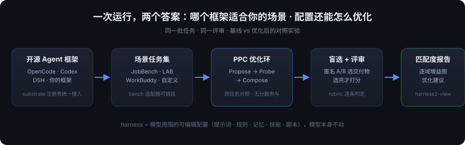
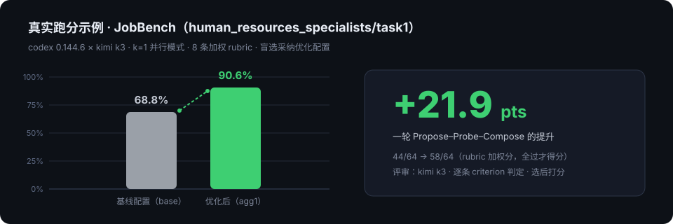

# best-harness

> 基于 [Google Harness²](https://github.com/google-research/harness2) 的 **agent 场景匹配度评估工作台**：
> 回答「市面上这么多开源 agent 框架，哪个最适合我的场景？」——并顺手把你的 harness 配置自动优化一轮。

**[English](README.md)** · 中文

<p>
  <a href="https://arxiv.org/pdf/2610.14224"></a>
  <a href="LICENSE"></a>
</p>

<p>
  
</p>

## 这个项目是什么

OpenCode、Codex、DeepSeek Harness…… 开源 agent 框架越来越多，但「哪个适合**我的**场景」一直没有量化的答案——跑分榜单是别人的场景，不是你的。

best-harness 做的事：

1. **横向可比**：让多个 agent 框架跑**同一批任务**、接受**同一评审**打分，按领域逐域对比——这才是"场景匹配度"；
2. **自动优化建议**：Harness² 的 Propose–Probe–Compose 循环会在每个任务上自动改进 harness 配置（提示词、规则、记忆、技能、脚本），并留下可阅读的改动 diff 和行为证据；
3. **报告可视化**：`harness2-view` 一键把跑分目录渲染成自包含 HTML 报告——逐域增益图、盲选溯源、轨迹回放到位。

## 关键机制

### harness = 模型周围的可编辑配置

模型权重不动，被优化的是围绕模型的 8 类组件：**系统提示词、守卫规则、长期记忆、工具指引、子代理、技能、脚本、插件**。改进器提案的每一个候选，都是磁盘上一组真实文件，可被审查、被 diff。

### Propose–Probe–Compose（PPC）

```
同一任务：基线配置执行 ──▶ 改进器读轨迹，提出候选（通用 inv / 领域 dom）
        ──▶ 每个候选在同一任务上试跑（唯一变量是配置）
        ──▶ 组合器从已观察到的行为差异中择优拼装 ──▶ 最终配置
```

**整个优化循环里没有分数参与**——改进器只看行为证据（轨迹、交付物、diff），永远看不到评分细则，从根上避免对评分器过拟合。

### 盲选 + 选后才打分

决赛交付物被匿名化为 A/B（映射由任务哈希打乱），选择器只看内容、不知道出自哪个配置；选择落定之后，LLM 评审才按 rubric 逐条判定打分。评审失败记「未评分」而不是 0 分。详细的打分漏斗与数据流走读见 [docs/WALKTHROUGH.zh.md](docs/WALKTHROUGH.zh.md)。

### 逐域增益：场景匹配度的量化答案

<p>
  
</p>

报告按领域聚合「基线 vs 优化后」的平均增益——哪个领域吃配置优化、哪个领域不换配置也行，一目了然；同一批任务换执行器再跑一轮，就是框架间的横向对比。

### 跨任务经验库

每个任务跑完后沉淀 cue/lesson/evidence 教训，写入按领域隔离的经验库，同领域后续任务的提案会读到——harness 随任务流持续变好。

## 支持的执行器与 benchmark

| 执行器（substrate） | 状态 | 说明 |
|---|---|---|
| OpenCode (`oc`) | 上游自带 | 三种 install mode |
| Codex CLI (`cx`) | 上游自带 | Responses 端点可配 |
| **DeepSeek Harness (`dsh`)** | **本分支新增** | headless NDJSON 轨迹、隔离 DSH_HOME、WB 容器镜像 |

| Benchmark | 任务类型 | 打分方式 |
|---|---|---|
| JobBench | 职业工作（35 个领域） | LLM 按加权 rubric 逐条判定 |
| LAB | 法律工作（1,143 任务） | LLM 按 criteria，Partial + All-pass |
| WorkBuddy | 办公 / 网页 / 代码 | 容器 verifier（code 子集为跑测试的硬分数） |
| 你自己的任务集 | —— | 见下文「加一个自己的 bench」 |

## 快速开始

```bash
# 安装（Linux, Python 3.12, uv）
uv venv --python 3.12 .venv && source .venv/bin/activate
uv pip install -e '.[render]'

# 不接模型的本地演示（跑通完整双模式递归）
harness2-demo --output runs/demo --k 2

# 真实跑一个 benchmark（以 JobBench + codex 为例；配好 .env 里的端点与密钥）
harness2-setup jb
harness2-check --bench jb --substrate cx
harness2 --bench jb --substrate cx --k 1 --mode parallel --max-tasks 1
harness2-judge --bench jb --substrate cx --k 1 --mode parallel
harness2-judge --bench jb --substrate cx --k 1 --mode parallel --bases   # 基线分数，增益对比用

# 生成可视化报告（中文界面；--lang en 出英文版）
harness2-view --runs runs -o runs/report.html
```

模型配置：`.env` 里 `HARNESS2_SOLVER_MODEL` / `HARNESS2_CODEX_*`（执行器）、`HARNESS2_IMPROVER_MODEL`（改进器）、`HARNESS2_JUDGE_MODEL`（评审）三个角色相互独立，judge 可指向任意 OpenAI 兼容端点。详见 [docs/SETUP.md](docs/SETUP.md)。

## 加一个自己的 bench

一个 benchmark = 实现 `BenchmarkAdapter` 协议的一个 Python 类（[harness2/core/spec.py](harness2/core/spec.py)），回答五个问题：

| 问题 | 要实现的方法 |
|---|---|
| 任务从哪来、怎么分域 | `tasks()` / `domain_of()` / `task_prompt()`（必须剥掉评分标准）/ `task_files()` |
| 怎么跑一次 | `execute()`（委托给 substrate）+ 一个 `BenchSpec`（install mode、防泄漏 globs） |
| 怎么判断交付了 | `delivered()` / `deliverable_text()` / `trajectory()`（渲染成共享的 `[ACTION]/[OBSERVATION]` 语法） |
| 基线是什么 | `base_harness()` + `validate_tree()` |
| 怎么打分 | `score()`（只在盲选后被调用；评审失败返回 `None` 而不是 0） |

然后在 [harness2/cli/_common.py](harness2/cli/_common.py) 的 `make_adapter` 注册。参照实现：[jobbench.py](harness2/benchmarks/jobbench.py)、[lab.py](harness2/benchmarks/lab.py)。

## 加一个自己的 agent 框架

substrate 只需实现 5 个方法（`surface / materialise / execute / read_trajectory / preflight`，见 [harness2/substrate/base.py](harness2/substrate/base.py)），然后在 [harness2/substrate/registry.py](harness2/substrate/registry.py) 注册一行——CLI 选项、适配器构造、帮助文本全部自动生效。参照本分支新增的 [dsh.py](harness2/substrate/dsh.py)。

## 文档

| 文档 | 内容 |
|---|---|
| [docs/WALKTHROUGH.zh.md](docs/WALKTHROUGH.zh.md) | **数据流与打分机制完整走读（中文，含图）** |
| [docs/SETUP.md](docs/SETUP.md) | 安装、模型与凭据配置 |
| [docs/BENCHMARKS.md](docs/BENCHMARKS.md) | 各 benchmark 的任务、领域与评分细则 |
| [docs/EXPERIMENTS.md](docs/EXPERIMENTS.md) | 递归预算、任务选择、复现性与防泄漏 |

## 致谢与许可

本项目基于 Google Research 的 [Harness²](https://github.com/google-research/harness2)（Apache-2.0）二次开发；上游方法与论文：

```bibtex
@article{xu2026harness2,
  title   = {Harness$^2$: Recursive Agent Harnessing for an Open World},
  author  = {Xu, Ruiyao and Chen, Yanfei and CuiZhu, Zhongying and Dalvi Mishra, Bhavana and Ming, Yifei and Yu, Han and Han, Rujun and Lee, Chen-Yu and Pfister, Tomas},
  journal = {arXiv preprint arXiv:2610.14224},
  year    = {2026}
}
```

本仓库代码以 [Apache-2.0](LICENSE) 发布；`third_party/` 下的第三方代码、benchmark 与数据集保留其上游许可（见 [dependencies/README.md](dependencies/README.md)）。
